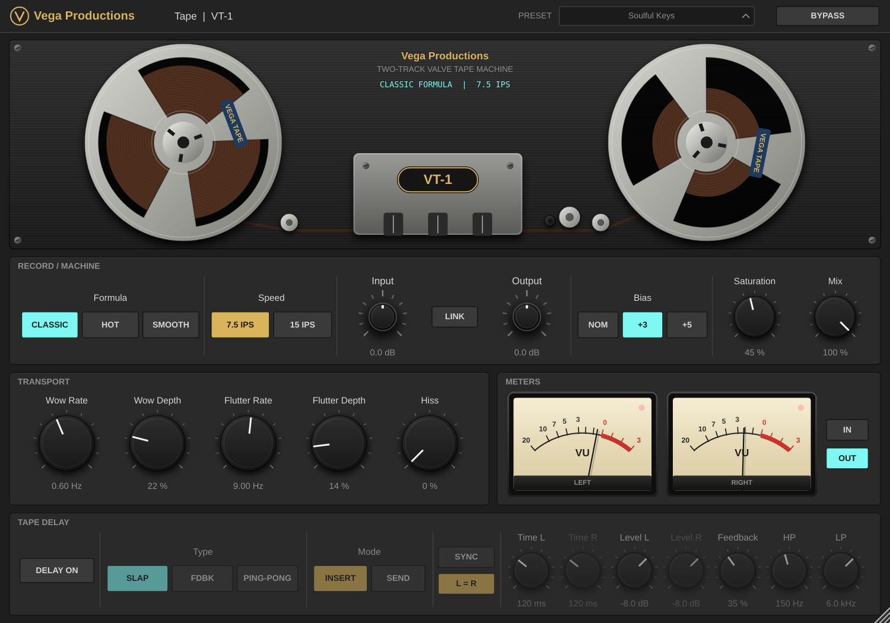

# Vega Productions — Tape (VT-1)



A two-track valve tape machine for your mixes and masters: warm harmonic saturation, head bump, tape speed and bias, wow and flutter, hiss, and a built-in tape delay. It builds as a VST3 for Windows, plus VST3 and AU for macOS.

## Signal flow

```
Input ─► [2x oversampled: pre-emphasis ─► tape saturation ─► de-emphasis]
      ─► head bump / HF loss (Speed + Bias + Formula) ─► hiss ─► wow & flutter
      ─► Mix ─► Output ─► Tape Delay (Insert or Send) ─► out
```

| Section | What it does |
|---|---|
| **Formula** | Three tape types. **Classic** is balanced with a round low end. **Hot** has more drive, more harmonics, a brighter top and a little more hiss. **Smooth** is cleaner and softer on top with less noise, which makes it good for masters. |
| **Speed** | **15 IPS** is tighter and more open, with the head bump around 58 Hz. **7.5 IPS** gives a fatter, darker low end, with the bump around 36 Hz, an earlier high-frequency roll-off and more hiss. |
| **Input / Output** | Input drives the tape harder. **LINK** turns the output down by the same amount you push the input, so you hear more colour at the same loudness. |
| **Bias** | **NOM** is the most harmonic setting. **+3** and **+5** over-bias the tape, which gives cleaner saturation and progressively darker highs, the way a real machine behaves. |
| **Saturation** | How hard the record amp and tape compress and distort. Auto make-up keeps the level steady. |
| **Mix** | Blends the dry signal back in for parallel tape. It is latency-aligned, so there is no phasing. |
| **Wow / Flutter** | Wow is the slow pitch drift (0.1–3 Hz) and includes a random speed wander. Flutter is the faster wobble (3–25 Hz). Depth is set as real speed deviation: up to 0.6 % for wow and 0.25 % for flutter. |
| **Hiss** | Shaped tape noise. It is louder at 7.5 IPS and with the Hot formula. |
| **Tape Delay** | Three types: **Slap** (a single echo), **Feedback** (repeats) and **Ping-Pong** (repeats that bounce L↔R). The repeats run through HP/LP filters and soft tape saturation, wobble along with the wow, and glide in pitch when you change the time. **Insert** adds the echoes to the signal. **Send** outputs echoes only, for a return/send bus. **SYNC** locks the times to the host tempo (1/32 up to 1/1, with triplet and dotted values), and **L = R** links the right time and level to the left. |
| **Meters** | Two analog VU meters (0 VU = −18 dBFS RMS) with peak lamps. Switch them between **IN** and **OUT**. |
| **Reels** | Spin while audio is playing. They run twice as fast at 15 IPS. |

### Factory presets
Init · Warm Vocal · Drum Bus Glue · Soulful Keys · Master Tape · Deep House Bass · Lo-Fi Wobble · Slapback Vocal · Dub Echo (Send) · Ping-Pong Groove

The plugin reports **243 samples of latency at 48 kHz** (5 ms tape path plus oversampling), and your DAW compensates for it automatically. Bypass stays latency-matched, so A/B comparisons are clean.

---

## Build it on GitHub (step by step)

1. **Create the repo.** On github.com, click **+ → New repository**. Name it `vega-tape`, leave everything else unchecked, and click **Create repository**.
2. **Upload the files.** Unzip `vega-tape.zip`.
   - *GitHub Desktop (easiest):* go to **File → Add local repository**, pick the unzipped `vega-tape` folder, then click **Publish repository**.
   - *Web upload:* on the empty repo page, click **uploading an existing file**. Drag **everything inside** the unzipped folder into the browser, including the `.github` folder, then click **Commit changes**.
     - If the `.github` folder didn't upload, use **Add file → Create new file**. Type `.github/workflows/build.yml` as the name, paste in the contents, and commit.
3. **Watch the build.** Open the **Actions** tab. "Build Vega Tape" runs automatically and takes about 10–15 minutes. It also runs a DSP self-test, which renders every preset and checks the harmonics, bypass and output levels.
4. **Download.** When the run finishes, a **Release** appears on the repo's main page. You can also open the finished run and scroll to **Artifacts**, where you'll find `VegaTape-Windows-VST3`.

## Install (Windows / FL Studio)
Unzip the download, then copy `Vega Productions Tape.vst3` to `C:\Program Files\Common Files\VST3\`.
In FL Studio, go to **Options → Manage plugins → Find more plugins**. The plugin appears under **Vega Productions**.

## Tips
- **Drum bus:** use the Hot formula at 15 IPS, push the Input +4 dB with LINK on, and set Saturation to about 55 %.
- **Soulful keys and Rhodes:** use 7.5 IPS with Bias +3, Wow Depth about 20 %, and Flutter at about 14 %.
- **Master bus:** use the Smooth formula at 15 IPS with Bias +3. Keep Saturation at 20–30 % and wow and flutter very low.
- **Dub echoes:** put the plugin on a return track in **Send** mode with Feedback, sync it at 1/4D, and use HP 250 Hz / LP 3.5 kHz.
